<div align="center">

# Dayboard

*A quiet dashboard for the spare display on your desk.*

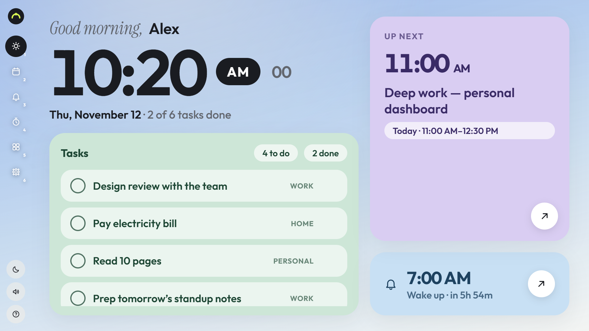


</div>

---

Dayboard turns any spare screen — an old laptop, a panel wired to a home server — into a calm
planner for the day: a big clock, today's tasks, the schedule, alarms, a focus timer, and a quiet
corner for notes and weather. Drive it from the keyboard attached to the display, or from your
phone over the same Wi-Fi. Every change appears on both, instantly.

No accounts, no cloud, no build step. One Node file, one JSON state file, and a browser in kiosk
mode.

## Features

- **Six pages** — Today, Schedule, Alarms, Focus, Extras, Settings. Arrow keys or `1`–`6`, from
  across the room.
- **A sky that follows the clock** — dawn peach, midday blue, dusk amber, with the sun travelling
  its arc. Auto mode hands over to a plain night sky after sunset.
- **Night sky** — twinkling stars, the occasional shooting star, and aurora curtains now and then.
- **Alarms & reminders** — full-screen, solid, unmissable. `Space` to dismiss, `Z` to snooze,
  auto-snooze if you walk away. Custom ringtones supported.
- **Hardware alerts** — ethernet unplugged, battery stopped charging, running hot. Shown on the
  display and your phone, auto-dismissed after ten seconds.
- **Phone remote** — open `/remote` on any device on the same Wi-Fi. Full control, and switching
  pages on the phone switches the display too (and vice versa).
- **Focus timer** — pomodoro with configurable cycles, short/long breaks and a session log.
- **Screensaver & power** — standby clock, rotating quotes or tasks, auto display-off, and a
  diagonal blur wipe when the screen sleeps and wakes.
- **Light, dark, auto** — auto follows daylight. Volume slider, brightness, sun-path shift,
  greeting name — all in Settings, all synced.
- **Weather & activity** — current conditions plus three days (Open-Meteo, no key needed), a
  month calendar, and a task-activity heatmap with streaks.

## In motion

**The sky follows the clock.** One day, dawn to dusk — gradient, sun position and greeting all
track the time. Shift sunrise and sunset to match your latitude in Settings.

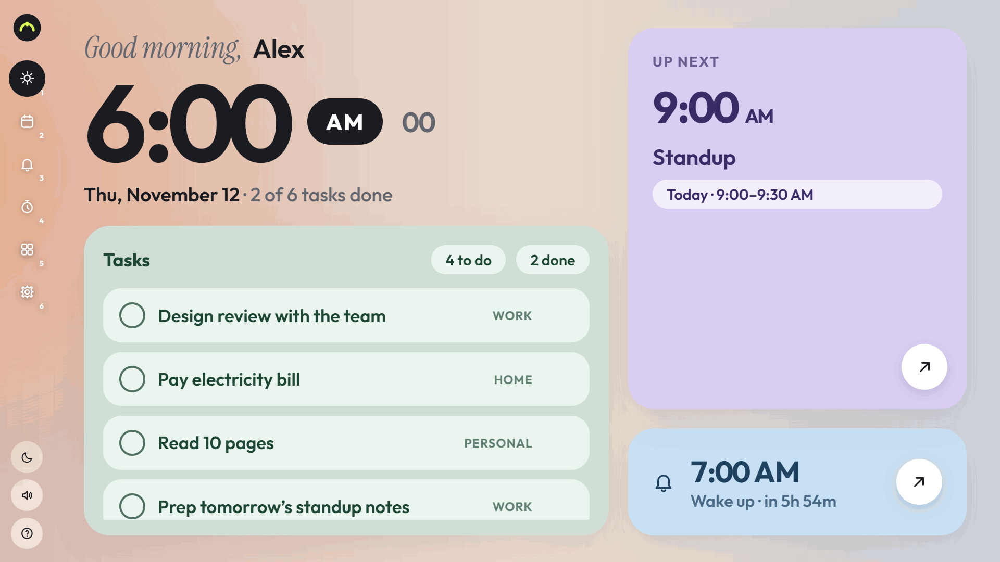

**After dark.** Stars twinkle, a shooting star crosses, and sometimes the aurora shows up.

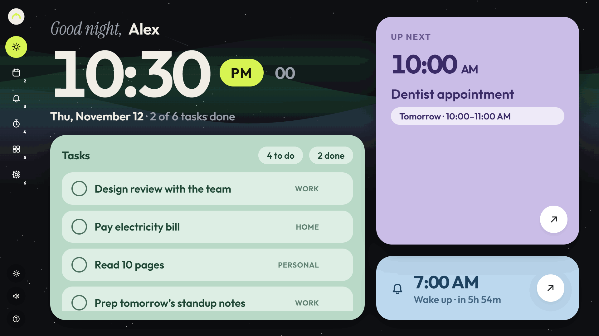

**Six pages, one keyboard.** The whole tour — also switchable from your phone, live.

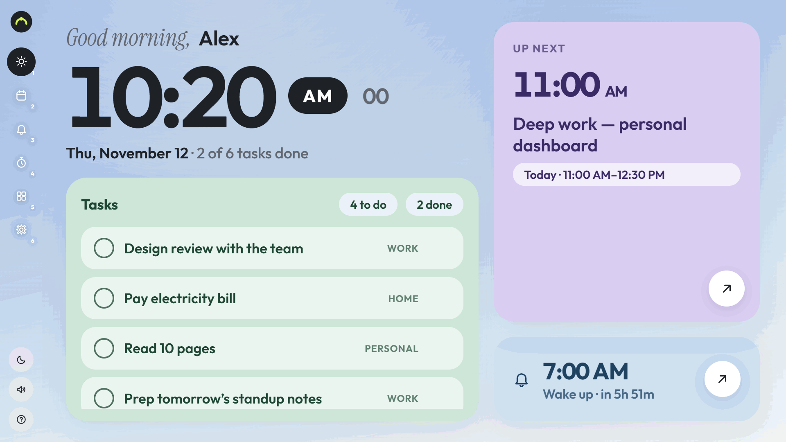

## Screenshots

| | |
|:---:|:---:|
|  | 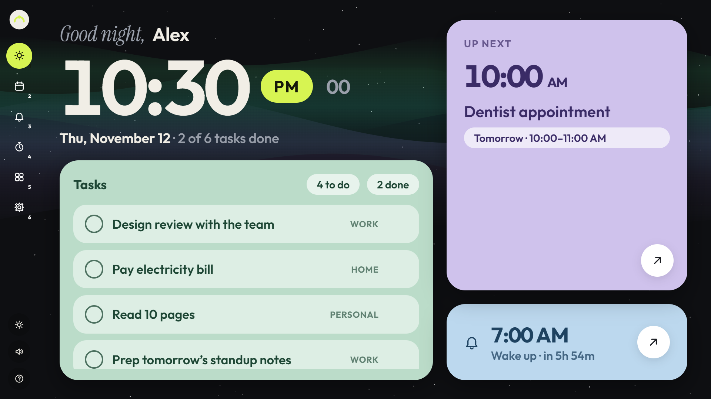 |
| Today, morning sky | Tonight, stars & aurora |
| 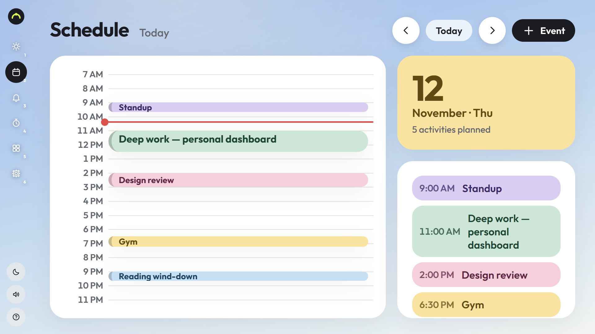 | 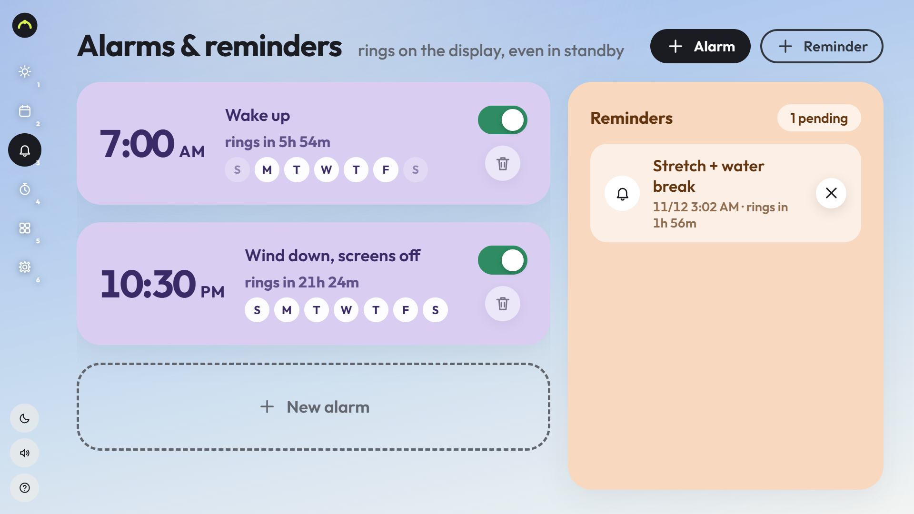 |
| Schedule, 12-hour day view | Alarms & reminders |
| 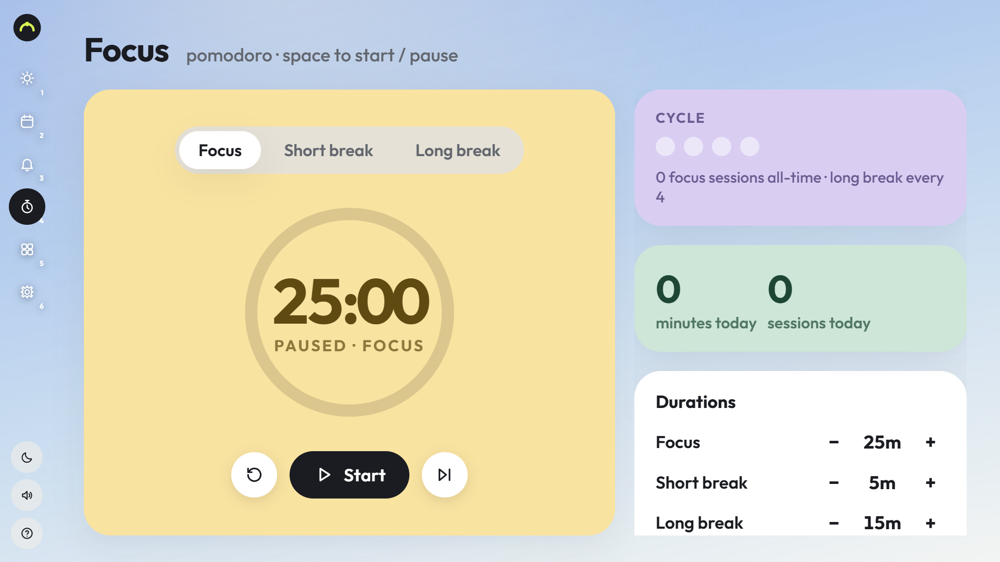 | 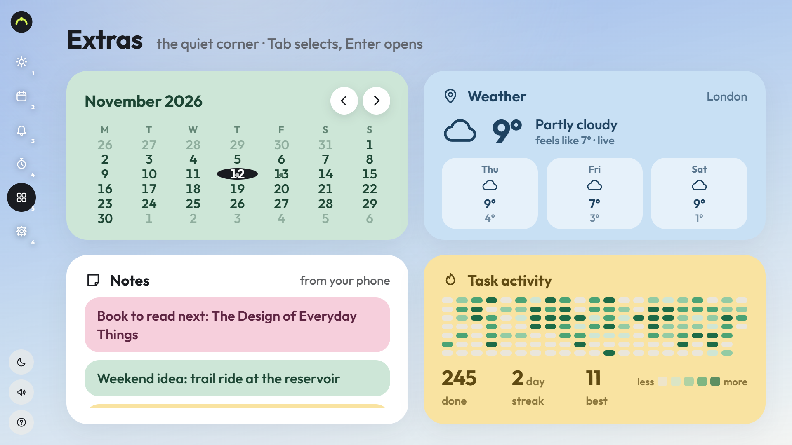 |
| Focus timer | Calendar, weather, notes, heatmap |
| 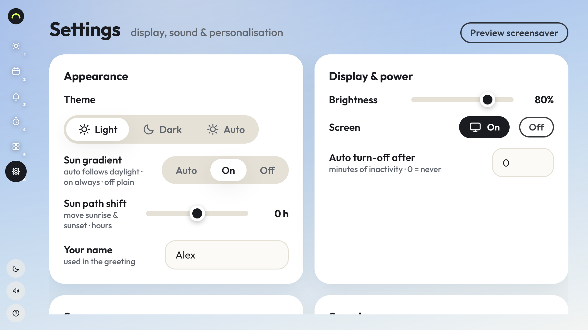 | 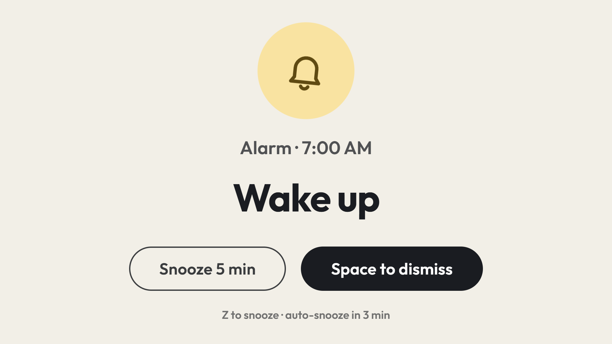 |
| Settings | Full-screen alarm |
| 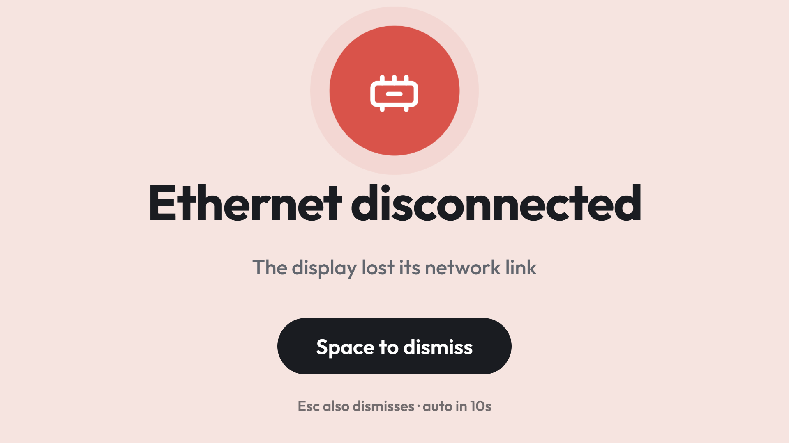 | 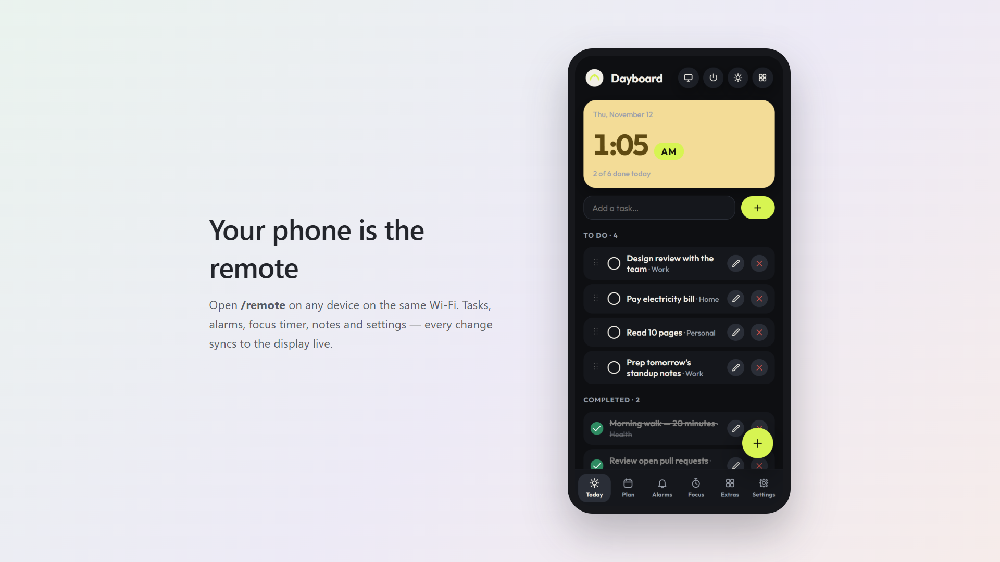 |
| Hardware alert | The phone remote |

## How it works

```
        keyboard                          Wi-Fi
           │                                │
   ┌───────▼────────┐   SSE + REST   ┌───────▼────────┐
   │  display (any  │◄──────────────►│  phone remote  │
   │  browser/kiosk)│                │  /remote       │
   └───────┬────────┘                └───────┬────────┘
           │        ┌────────────────┐       │
           └───────►│  server.mjs    │◄──────┘
                    │  Node, 0 deps  │
                    │  data/state.json│
                    └───────┬────────┘
                            │ optional, token-authenticated
                    ┌───────▼────────┐
                    │  host agent    │  brightness · DPMS · mute
                    │  (python3)     │  ethernet · battery · temp
                    └────────────────┘
```

The server owns all state and all timers — alarms fire even if no browser is open. Clients
subscribe to a server-sent event stream, so display and phone never disagree. The optional host
agent runs on the machine physically attached to the panel and exposes brightness, display
power, mute and hardware sensors over a small token-authenticated HTTP API.

## Install

Requirements: **Node 18+** anywhere (container, VM, bare metal). A browser for the display.
Python 3 only if you want the optional host agent.

### 1 · Proxmox LXC

Create a small Debian container (512 MB of RAM is plenty):

```sh
pct create 120 local:vztmpl/debian-12-standard_12.7-1_amd64.tar.zst \
  --hostname dayboard --memory 512 --cores 1 --rootfs local-lvm:4 \
  --net0 name=eth0,bridge=vmbr0,ip=dhcp --unprivileged 1 --onboot 1
pct start 120
```

*(Adjust the template name to whatever `pveam available` lists on your host.)*

Inside the container, install Node and unpack the app:

```sh
pct enter 120
apt update && apt install -y nodejs        # Debian 12 ships Node 18
mkdir -p /opt/dayboard /etc/dayboard
touch /etc/dayboard/env
```

From your workstation, ship the code in:

```sh
tar -cf dayboard.tar server.mjs public host
scp dayboard.tar root@<proxmox-host>:/tmp/
ssh root@<proxmox-host> 'pct push 120 /tmp/dayboard.tar /tmp/dayboard.tar && \
  pct exec 120 -- bash -c "cd /opt/dayboard && tar -xf /tmp/dayboard.tar --no-same-owner"'
```

Install the service (the unit file is in [`host/dayboard.service`](host/dayboard.service)):

```sh
cp /opt/dayboard/host/dayboard.service /etc/systemd/system/
systemctl enable --now dayboard
```

Open `http://<container-ip>:4000` — first run seeds itself with demo content.

### 2 · Any container or bare metal

```sh
git clone https://github.com/Saiwilan/Dayboard.git
cd Dayboard
node server.mjs                 # http://localhost:4000
```

Or as a container image:

```dockerfile
FROM node:22-alpine
WORKDIR /app
COPY server.mjs ./
COPY public ./public
EXPOSE 4000
CMD ["node", "server.mjs"]
```

```sh
docker build -t dayboard .
docker run -d -p 4000:4000 -v dayboard-data:/app/data --name dayboard dayboard
```

The same systemd unit from step 1 works on any Linux box with Node at `/usr/bin/node`.

### 3 · The display

Point any browser at the server and make it a kiosk. On the machine attached to the panel:

```sh
chromium --kiosk --noerrdialogs --disable-session-crashed-bubble \
  --autoplay-policy=no-user-gesture-required http://<container-ip>:4000
```

Run it from an auto-login session, or wrap it in a systemd service so the dashboard comes back
after a reboot. Audio matters for alarms — allow autoplay, as above.

### 4 · Optional: the host agent

Without it, Dayboard is fully functional; brightness/power/mute controls and hardware alerts
simply stay hidden. With it, the Settings page gains real backlight and DPMS control, and the
display alerts you when the network cable goes out or the battery stops charging.

On the machine with the panel (needs X11 and sysfs access):

```sh
mkdir -p /etc/dayboard-agent
openssl rand -hex 16 > /etc/dayboard-agent/token
python3 host/agent.py           # listens on :8009
```

Then tell the server where to find it, in `/etc/dayboard/env` (or the container's environment):

```sh
DISPLAY_AGENT_URL=http://<display-host-ip>:8009
DISPLAY_AGENT_TOKEN=<the same token>
```

A ready-made unit lives at [`host/dayboard-agent.service`](host/dayboard-agent.service).

### Configuration

| Variable | Default | Purpose |
|---|---|---|
| `PORT` | `4000` | HTTP + SSE port |
| `HOST` | `0.0.0.0` | Bind address |
| `DISPLAY_AGENT_URL` | *(empty)* | Host agent base URL; empty disables hardware features |
| `DISPLAY_AGENT_TOKEN` | *(empty)* | Shared secret for the agent |

All state lives in `data/state.json` (created on first run, written atomically). Delete it to
reseed the demo content. Uploaded ringtones and screensaver videos live beside it.

## Keyboard

| Key | Action |
|---|---|
| `1`–`6`, `←` `→` | Switch page |
| `Tab`, `↑` `↓` | Move selection · `Enter` opens |
| `Space` | Toggle task · start/pause focus · dismiss alarm |
| `N` / `Shift+N` | New task/event/alarm/note (per page) · new reminder |
| `E` / `Del` | Edit / delete selected task |
| `,` `.` | Previous / next day (Schedule) |
| `[` `]` | Brightness down / up |
| `M` · `T` · `S` · `O` | Mute · theme · screensaver · display off/on |
| `Z` | Snooze alarm |
| `?` or `H` | Help overlay |
| `Esc` | Close anything |

## Privacy

Everything stays on your LAN. No accounts, no telemetry, no external calls except Open-Meteo
for weather (only if you set a location). The state file never leaves the machine it lives on.

## Credits

Made by **Qwen 4 Max Preview**.

Type set in Outfit and Instrument Serif. Weather by Open-Meteo.
